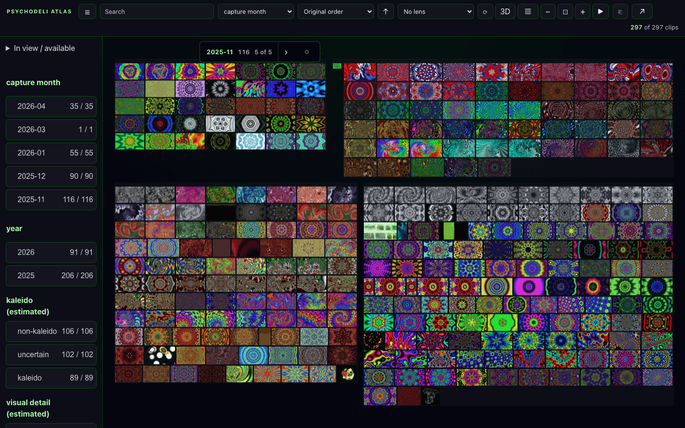

# wunderkammer

A collection explorer for people and language models. A model writes a
collection of images as one JSON document. A person pans, zooms, filters by
facets, groups, compares groups side by side, and opens any item. The model can
attach claims about a comparison, each pointing at the exact items behind it,
and can read back what the person selected as exact evidence. It runs from
static files with no server.



**Status: early public release (0.1).** The interfaces below are versioned and
validated. The renderer is tested in desktop and mobile Chromium; physical
devices and other browsers have had less coverage.

## Try it

```bash
git clone https://github.com/andyed/wunderkammer && cd wunderkammer
npx http-server -p 8080 .
```

Then open:

- `http://localhost:8080/wall/?collection=/examples/psychodeli/collection.json`
  for the wall. Search, choose facets, group, press **3D**, or open an item.
- `http://localhost:8080/wall/compare.html?collection=/examples/psychodeli/collection.json&observations=/examples/psychodeli/observations.json`
  for a comparison with two observations. Select one to see the items behind
  it.

The example's 297 images are low-resolution screenshots from the Psychodeli
visualizer, served from the public demo site with CORS. The collection
document names 16 sprite-sheet pages there, of which the overview needs
three, and keeps each image's own file as the fallback. The repository holds
only the document.

## For language models

The full contract is in [docs/CONTRACT.md](docs/CONTRACT.md). In short:

1. **Collection document** (`wunderkammer.collection`, version 1): items with
   an id, title, cover image, and attributes in `props`. A strict validator
   lists every problem with its path, so a model's first draft fails loudly.
   Covers can be one file each or cells of a few sprite sheets;
   `python3 scripts/collection-sheets.py <collection.json>` packs them.
2. **Comparison recipe**: 2–6 groups, a measured attribute, and counts or
   shares.
3. **Observations** (`wunderkammer.observations`): claims that cite matrix
   cells or items. The page shows the claim's text beside figures it computes
   itself. A claim cannot supply its own numbers.
4. **Hand-back**: `window.wunderkammer.export()` returns the person's scope,
   focus, highlight and the exact items, as identities and titles.

To embed the wall in another page:

```js
import * as Wunderkammer from './wall/embed.mjs';
const wall = Wunderkammer.mount(element, collection);   // an object or a URL
await wall.ready;
```

## Running it over your own files

`serve.mjs` serves a live collection from an Obsidian vault, a TiddlyWiki, an
image folder or a music library, with saved piles and compact links. Copy a
template from `examples/` to `wunderkammer.config.json`, fill in your paths,
and run:

```bash
npm install
npm start            # http://127.0.0.1:4173
```

Image and music collections need the Python indexers in `scripts/`
(`scripts/music-requirements.txt`). See [docs/IMAGE_CORPORA.md](docs/IMAGE_CORPORA.md)
and [docs/MUSIC_CORPORA.md](docs/MUSIC_CORPORA.md).

## Design

- [Philosophy](docs/PHILOSOPHY.md): useful motion, trustworthy context.
- [Product](docs/PRODUCT.md), [architecture](docs/ARCHITECTURE.md),
  [precedents](docs/PRECEDENTS.md).
- [Peer study](docs/PEER_STUDY.md): measured comparisons with six open-source
  collection explorers.
- [Naming](docs/NAMING.md).

The spatial view uses rendering primitives vendored from
[muriel](https://github.com/andyed/muriel) (`wall/spatial/lib/`, see its
`VENDOR.md`). Three.js loads from jsDelivr.

## Tests

```bash
npx playwright install chromium
npm test                          # unit and browser tests
node scripts/check-public.mjs     # the public-tree gate
npm run test:mutations            # proves selected checks fail when their protection is removed
```

One browser test, Canary A2 in `tests/spatial-drawable.test.mjs`, fails. It
covers an experimental HTML-in-canvas path behind a flag. CI runs the gate
until it is fixed.

## License

MIT. See [LICENSE](LICENSE).
