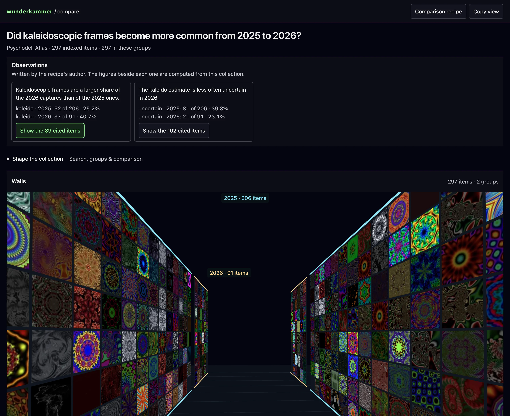
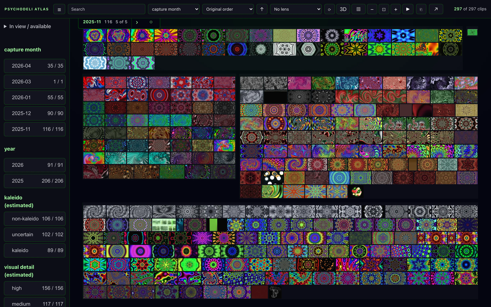
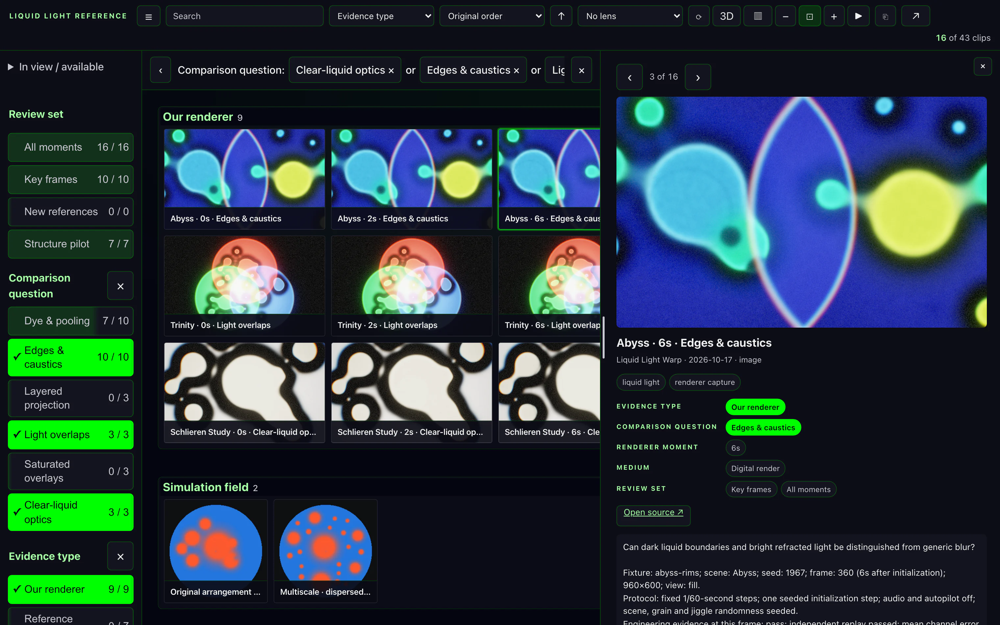
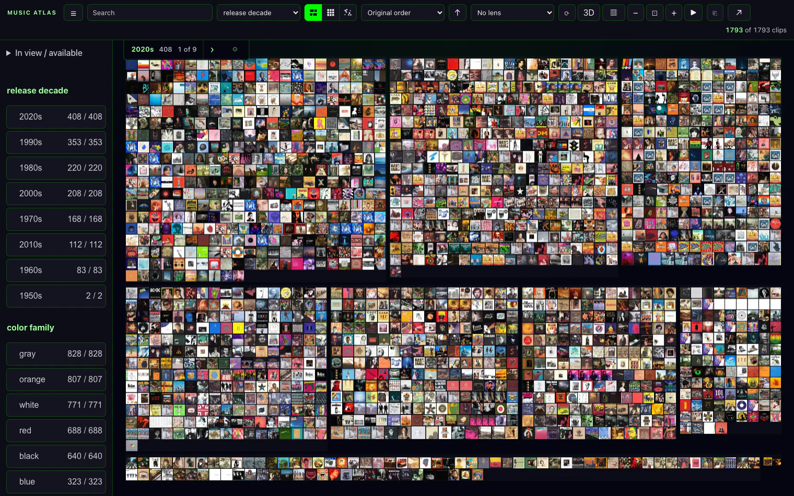
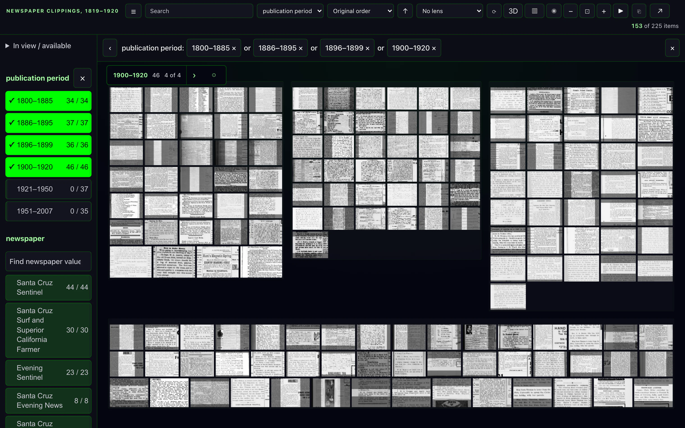
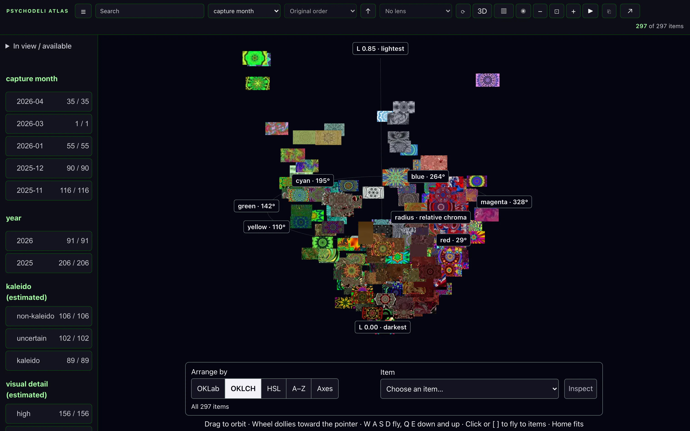

# wunderkammer

A collection explorer for people and language models. A model writes a
collection of images as one JSON document. A person pans, zooms, filters by
facets, groups, compares groups side by side, and opens any item. The model can
attach claims about a comparison, each pointing at the exact items behind it,
and can read back what the person selected as exact evidence. It runs from
static files with no server.

**[Open the live demo →](https://andyed.github.io/clipwall-demo/)** 297 frames from the Psychodeli
visualizer, served as static files from GitHub Pages. Each link opens a
different view of the same collection:

- **[The wall](https://andyed.github.io/clipwall-demo/)**: every frame, grouped by capture month. The overview
  paints from 3 sprite-sheet images instead of 297 files.
- **[One facet](https://andyed.github.io/clipwall-demo/?facet.kaleido=kaleido&group=year)**: the 89 kaleidoscopic
  frames, grouped by year. The rest stay reachable as context when you zoom
  out.
- **[The hallway](https://andyed.github.io/clipwall-demo/?view=aisle&group=year)**: one rack per year. Walk it
  with the slider, drag to look around, and select a frame to open it.
- **[Stacks in 3D](https://andyed.github.io/clipwall-demo/?view=3d&group=year)**: each year as a stack you can
  open and spread.
- **[The colour space](https://andyed.github.io/clipwall-demo/?view=float&arrange=oklch)**: every frame floats at
  its dominant colour, with hue around the ring and lightness up. Click one
  to fly to it.
- **[Your own axes](https://andyed.github.io/clipwall-demo/?view=float&arrange=axes&across=year&up=lightness&depth=hue)**:
  year across, lightness up, hue in depth. Change any axis from the menus.

**Status: early public release (0.1).** The interfaces below are versioned and
validated. The renderer is tested in desktop and mobile Chromium; physical
devices and other browsers have had less coverage.

## What it's for

### 1. A model makes a claim you can check

The model writes a collection and a comparison, and attaches observations that
cite exact cells. The page shows each claim's text beside figures it computes
itself. Selecting one lights its evidence in the matrix and on the walls.



### 2. Explore a large image collection

Survey everything at once, filter with facets that show their counts, then
open an item and come back to where you were.



### 3. Keep a reference board for a creative project

Clippings and captures sit together, faceted by what they're evidence of. Open
one and read its notes without losing the board.



### 4. Browse your own library at scale

`serve.mjs` reads a music or photo folder and serves it as a live collection,
with saved piles and links.



### 5. Work through an archive

Documents rather than art: clippings grouped by publication period, filtered
to the years in question.



### 6. Pivot a collection on the dimension you choose

Choose a dimension and every image floats in 3D at its place along it.
Choose another and the same images travel to their new places, so one item
can be followed from arrangement to arrangement. In the floating space (✺), a
dimension is an image's dominant colour (OKLab, OKLCH or HSL) or its title
(A–Z). Under Axes, each axis takes a dimension of its own: the lightness,
chroma or hue of the colour, or an attribute such as year or a facet. With a search or facets
set, the images outside the scope dim in place and nothing moves. Click an
image to fly to it and open it.



Live link, with the example served as in [Try it](#try-it):
`http://localhost:8080/?collection=/examples/psychodeli/collection.json&view=float&arrange=oklch`

Shots 1, 2 and 6 show the bundled example; 3–5 are local collections run on
the same engine.

## Try it

```bash
git clone https://github.com/andyed/wunderkammer && cd wunderkammer
npx http-server -p 8080 .
```

Then open:

- `http://localhost:8080/?collection=/examples/psychodeli/collection.json`
  for the wall. Search, choose facets, group, press **3D** or **✺**, or open
  an item.
- `http://localhost:8080/wall/compare.html?collection=/examples/psychodeli/collection.json&observations=/examples/psychodeli/observations.json`
  for a comparison with two observations. Select one to see the items behind
  it.

The example's 297 images are low-resolution screenshots from the Psychodeli
visualizer, served from the public demo site with CORS. The collection
document names 16 sprite-sheet pages there, of which the overview needs
three, and keeps each image's own file as the fallback. The repository holds
only the document.

## For language models

Wunderkammer is best used from [muriel](https://github.com/andyed/muriel),
a design skill for coding agents. muriel decides when a collection explorer
is the right way to show something, builds the document from a folder or a
CSV, and reviews the result for exploration quality and contrast.

Without muriel, agents start with the skill,
[skills/wunderkammer/SKILL.md](skills/wunderkammer/SKILL.md): when to use
Wunderkammer, the steps from document to link, and the traps. Install it with
`npx skills add andyed/wunderkammer`, or copy the folder into your agent's
skills directory. Either way, before handing over a link, check the
document, and any observations, the way the pages will read them:

```bash
node scripts/validate-collection.mjs collection.json --observations observations.json
```

It lists every problem with its path, every local cover file that is missing,
and the figures each observation will show, and exits 1 when anything needs
fixing.

The full contract is in [docs/CONTRACT.md](docs/CONTRACT.md). In short:

1. **Collection document** (`wunderkammer.collection`, version 1): items with
   an id, title, cover image, and attributes in `props`. A strict validator
   lists every problem with its path, so a model's first draft fails loudly.
   Covers can be one file each or cells of a few sprite sheets;
   `python3 scripts/collection-sheets.py <collection.json>` packs them.
2. **Comparison recipe**: 2–6 groups, a measured attribute, and counts or
   shares.
3. **Observations** (`wunderkammer.observations`): claims that cite matrix
   cells or items. The page shows the claim's text beside figures it computes
   itself. A claim cannot supply its own numbers.
4. **Hand-back**: `window.wunderkammer.export()` returns the person's scope,
   focus, highlight and the exact items, as identities and titles.

To embed the wall in another page:

```js
import * as Wunderkammer from './wall/embed.mjs';
const wall = Wunderkammer.mount(element, collection);   // an object or a URL
await wall.ready;
```

## Running it over your own files

`serve.mjs` serves a live collection from an Obsidian vault, a TiddlyWiki, an
image folder or a music library, with saved piles and compact links. Copy a
template from `examples/` to `wunderkammer.config.json`, fill in your paths,
and run:

```bash
npm install
npm start            # http://127.0.0.1:4173
```

Image and music collections need the Python indexers in `scripts/`
(`scripts/music-requirements.txt`). See [docs/IMAGE_CORPORA.md](docs/IMAGE_CORPORA.md)
and [docs/MUSIC_CORPORA.md](docs/MUSIC_CORPORA.md).

## Design

- [Philosophy](docs/PHILOSOPHY.md): useful motion, trustworthy context.
- [Product](docs/PRODUCT.md), [architecture](docs/ARCHITECTURE.md),
  [precedents](docs/PRECEDENTS.md).
- [Peer study](docs/PEER_STUDY.md): measured comparisons with six open-source
  collection explorers.
- [Naming](docs/NAMING.md).

Three.js loads from jsDelivr.

## Related projects

[muriel](https://github.com/andyed/muriel), a design skill for coding agents by
the same author, supplies the spatial view's rendering primitives. They are
vendored in `wall/spatial/lib/`; see its `VENDOR.md`.

Other open-source collection explorers, compared in the
[peer study](docs/PEER_STUDY.md). Licences were read from each project's
LICENSE file in October 2026.

- [VIKUS Viewer](https://github.com/cpietsch/vikus-viewer) (MIT): timeline and
  similarity layouts for cultural collections, as a static site.
- [PixPlot](https://github.com/pleonard212/pix-plot) (MIT): WebGL atlases of
  large image collections laid out by similarity.
- [Collection Space Navigator](https://github.com/Collection-Space-Navigator/CSN)
  (MIT): projections with range and text filters over image collections.
- [Embedding Atlas](https://github.com/apple/embedding-atlas) (MIT):
  cross-filtered views of millions of points, with an MCP server for agents.
- [Piling.js](https://github.com/flekschas/piling.js) (MIT): interactive piles
  of small multiples.
- [seajax](https://github.com/seajax/seajax) (BSD), an open-source clone of
  Microsoft's PivotViewer and the ancestor of faceted zooming over image
  collections.

## Tests

```bash
npx playwright install chromium
npm test                          # unit and browser tests
node scripts/check-public.mjs     # the public-tree gate
npm run test:mutations            # proves selected checks fail when their protection is removed
```

One browser test, Canary A2 in `tests/spatial-drawable.test.mjs`, fails. It
covers an experimental HTML-in-canvas path behind a flag. CI runs the gate
until it is fixed.

## License

MIT. See [LICENSE](LICENSE).
